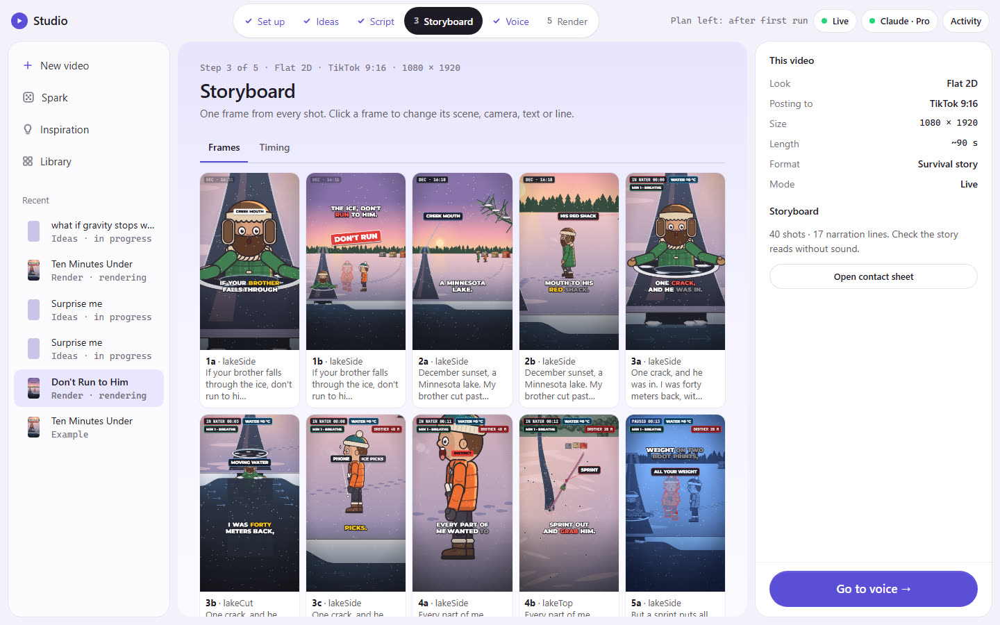
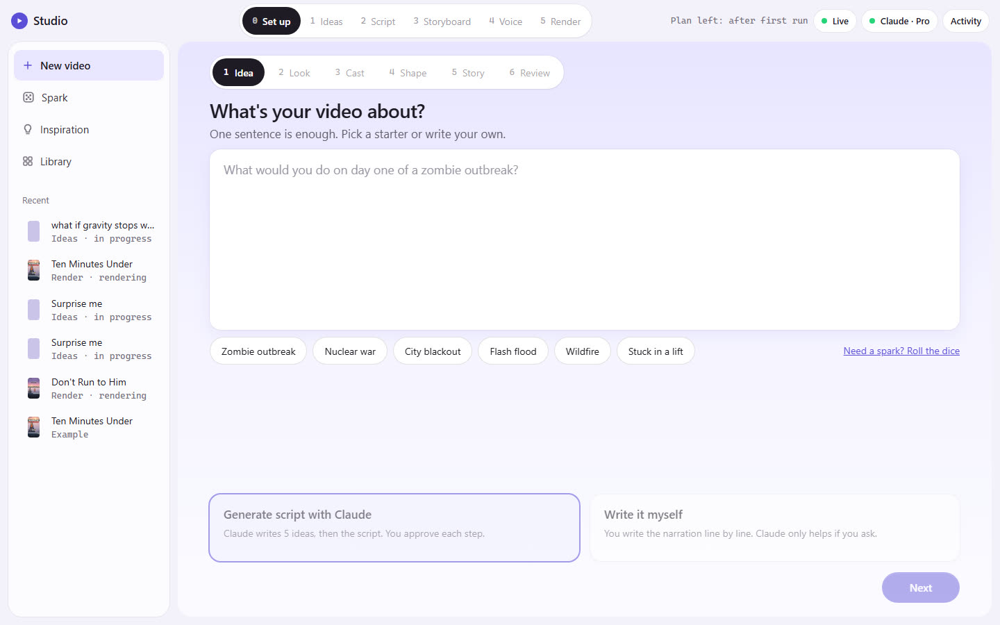
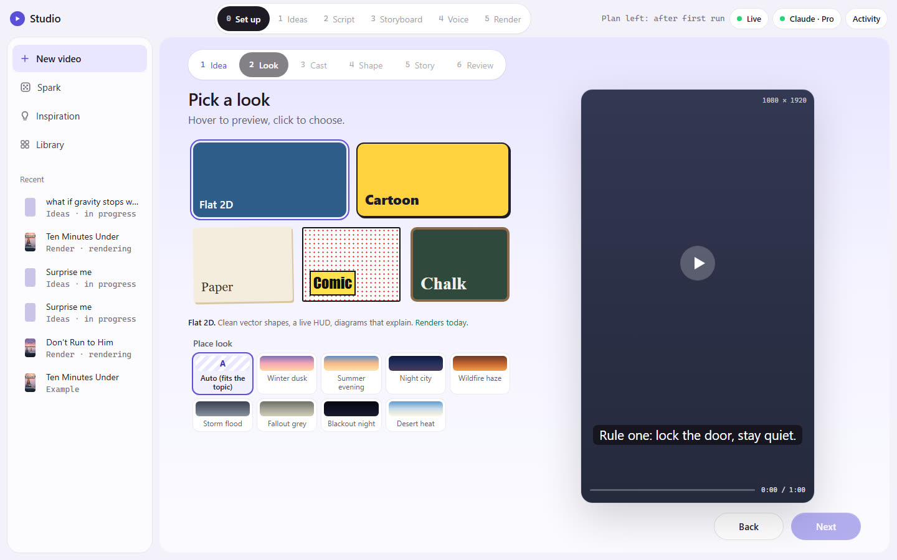
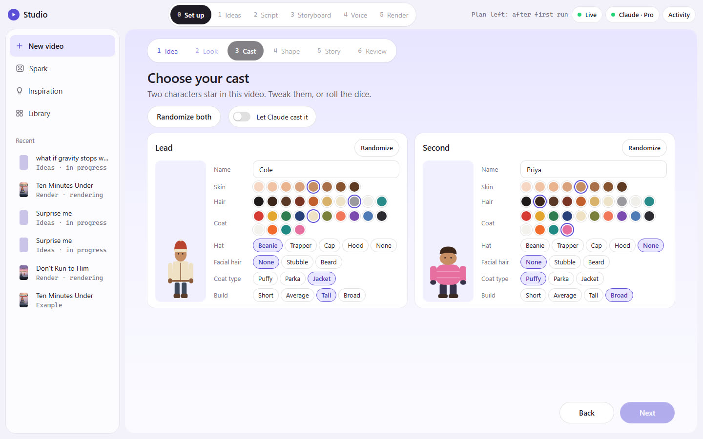
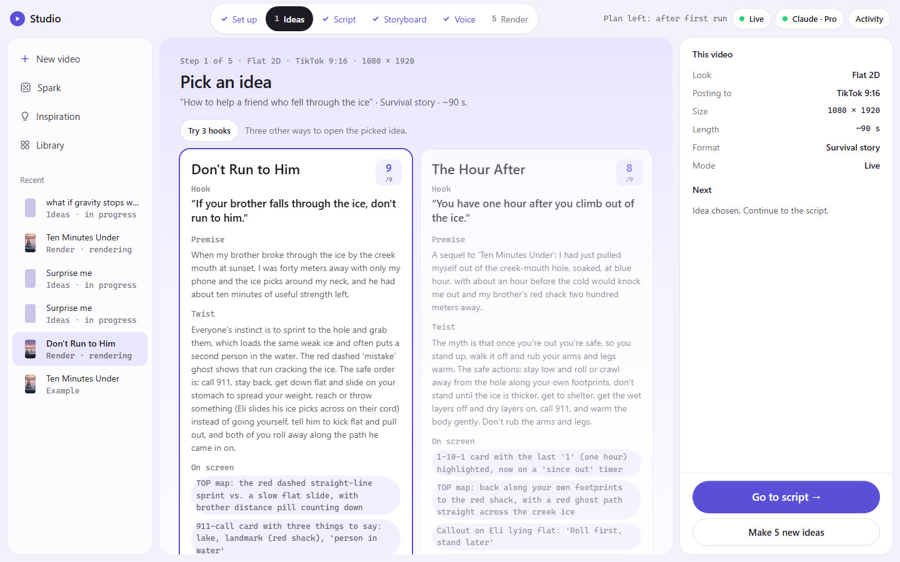
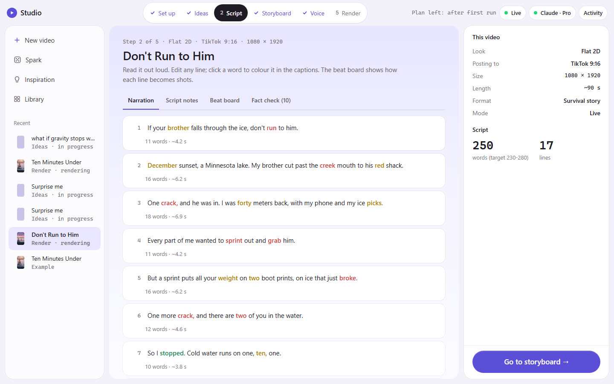
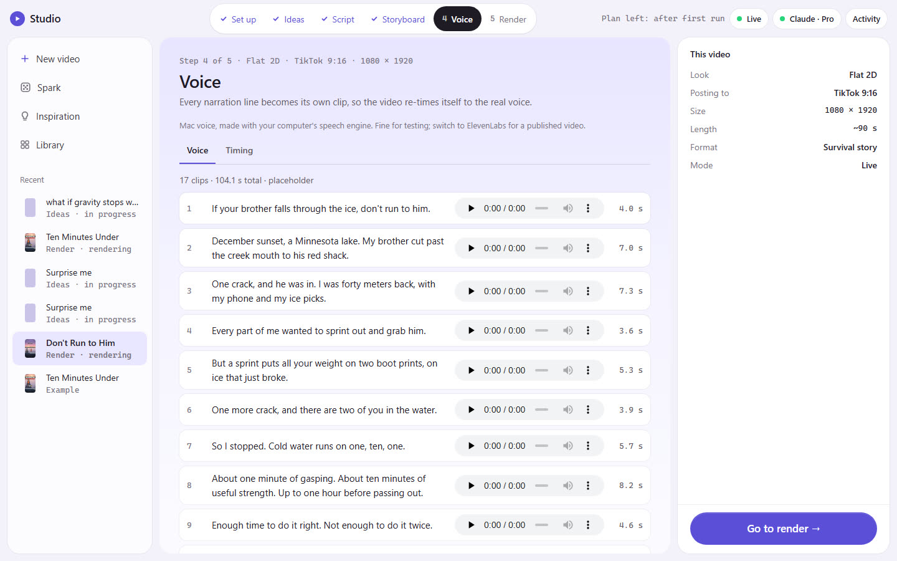
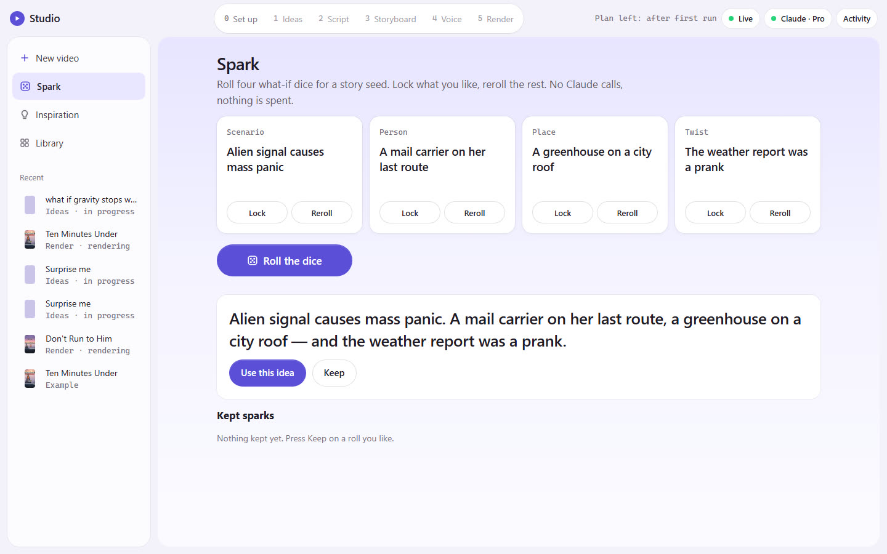
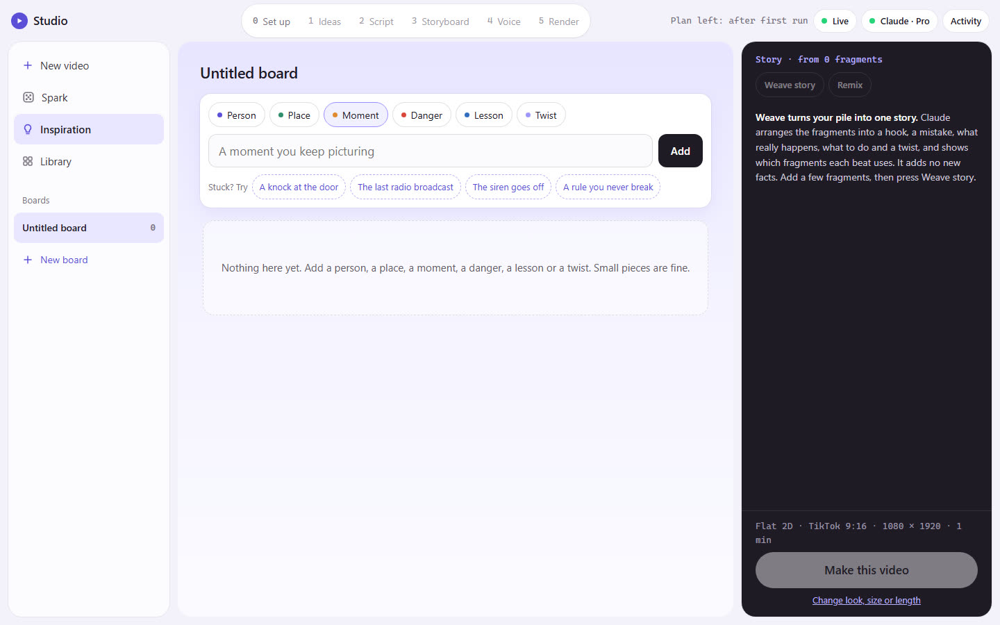
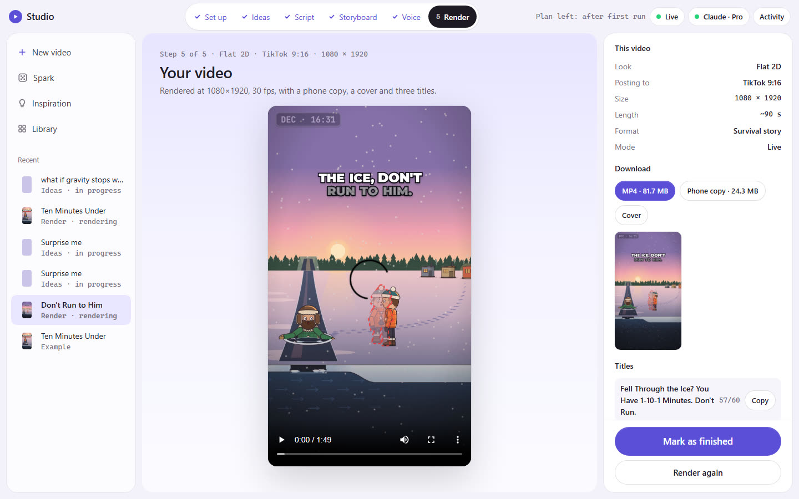

# Studio Gen

**Turn one sentence into a finished, narrated 2D video.** Type a topic, roll the dice in *Spark* or build
a story from fragments in *Inspiration*. Then approve the ideas → the script → the storyboard → the
voice, and get an MP4, a phone copy, a cover and three titles.

Studio Gen is a local app. It uses **your own Claude Code** (already installed and signed in) as its AI,
**ElevenLabs** for the voice (optional) and **Remotion** for the render. You never see a terminal
prompt, a skill file or a setting. You only decide and approve.



| | | |
|---|---|---|
|  |  |  |
|  |  |  |
|  |  |  |

The project screens show a real live run: topic *"How to help a friend who fell through the ice"* →
idea *"Don't Run to Him"* → a 250-word script → 40 shots → a 1:49 MP4 (`episodes/how-to-help-a-friend-2611071750/`).
That run used the labelled placeholder voice because no ElevenLabs key was set.

## Quick start (5 minutes)

You need **Node.js 20+** and **Claude Code** signed in to your Claude account
([install guide](https://docs.claude.com/en/docs/claude-code/setup)). ElevenLabs is optional.

```bash
npm ci --ignore-scripts        # install packages (no install scripts run)
npx remotion browser ensure    # one-time: Remotion's headless browser (~120 MB)
npm run doctor                 # pass/fail table with the fix for each failure
npm start                      # opens Studio in your browser (live mode)
```

**No terminal needed:** double-click `Start Studio.cmd` on Windows or `Start Studio.command` on a Mac.
For the free demo, use `Start Demo (Replay).cmd` / `.command`.

No Claude account handy, or on stage with bad Wi-Fi? Use **Replay**:

```bash
npm run demo                   # the whole flow from recorded runs: zero Claude calls, no keys
```

Replay plays back recorded stage runs and the cached outputs of the finished example episode
*Ten Minutes Under*. It is always labelled **Replay** and never pretends to be live.

`npm start` prints a private link (`http://127.0.0.1:4317/?t=…`) and opens it. Studio only listens on
127.0.0.1 and answers only requests that carry that token. If a tab shows "Open Studio from the terminal
link", copy the `Open:` link from the Studio window.

## What you can do

**Start a video your way**

- **New video:** a guided six-screen setup.
  - **Idea:** one sentence, or a starter like *Flash flood* or *City blackout*.
  - **Look:** Flat 2D, Cartoon, Paper, Comic or Chalk, plus a place look such as *Winter dusk*, *Night city*,
    *Wildfire haze* or *Storm flood*.
  - **Cast:** name and dress the two characters, roll the dice, or let Claude cast them.
  - **Shape:** format and length.
  - **Story:** let Claude write it, or *write it myself*.
  - **Review.**
- **Spark:** roll four what-if dice (scenario, person, place, twist), lock the ones you like and use the
  idea. It makes no Claude calls and costs nothing.
- **Inspiration:** drop fragments (a person, a place, a moment, a danger, a lesson, a twist) on a board.
  *Weave story* turns them into a hook, a mistake, what really happens, what to do and a twist.
- **Make the next episode:** turn a finished video into a series. The new episode keeps the cast, look
  and format, and carries a short "previously" note into the writing.

**Five approval steps**

| Step | Who does it | What you get (in `episodes/<slug>/`) | You |
|---|---|---|---|
| Connect | Anthropic's own sign-in (`claude auth login`) | green "Claude connected" pill | one click |
| 1 Ideas | Claude Opus 5.5 (structured output) | `ideas.json`: 5 ideas with hook, twist, world, diagrams, fact, risk, score | pick one |
| 2 Script | Claude Opus 5.5 | `script.md`, `lines.json`, `shotlist.md` (beat board); script editor and hook lab | edit / approve |
| 3 Storyboard | Claude Sonnet 5.5 edits `src/shots.ts`; Studio typechecks and renders one still per shot | stills, frame editor, timing table | approve |
| 4 Voice | ElevenLabs (one clip per line, stitched), your computer's voice, or none (captions only) | `voice/line-N.mp3`, `src/audio.json` | listen, accept |
| 5 Render | Remotion; Claude Sonnet writes the titles | `episode.mp4`, `episode-phone.mp4`, `cover.png`, `titles.json` | download |

**Formats and length:** TikTok, Shorts and Reels (9:16), YouTube (16:9), square and 4:5 feeds, or a custom
size. Length is anything from 20 to 180 seconds.

**Plan guard:** the top bar shows how much of your Claude plan is left (5-hour and weekly windows), and
Studio won't start a step that would run past it. If a limit is hit mid-step, the step pauses with its
work kept.

Everything that makes the video good (the `story-explainer-2d`, `survival-short` and
`cinematic-director` skills, the prompts, the model routing, the art kit) is built in. You can read the
skills in **Library → Skills**.

## Legal, safety and privacy

- **Local and non-commercial.** A hackathon project. Bring your own Claude Code login and, if you want
  a real voice, your own ElevenLabs key.
- **Your Claude login stays with Claude Code.** Studio runs the `claude` program on your machine.
  - It never reads, copies, logs, stores or forwards Claude credentials or tokens.
  - It never runs `claude setup-token` and never uses `--bare`.
  - It removes `ANTHROPIC_API_KEY`, `ANTHROPIC_AUTH_TOKEN` and `CLAUDE_CODE_OAUTH_TOKEN` from every
    Claude run, so your subscription login is what is used. `npm run doctor` warns if any is set.
- **No secrets in files.** `ELEVENLABS_API_KEY` comes from your environment, or you paste it in the
  app, where it is kept in memory only. `.env*` is git-ignored.
- **ElevenLabs free plan** is non-commercial, and published videos must credit **"elevenlabs.io"** in
  the title. Studio adds the credit to the titles it writes when it detects (or cannot rule out) a free
  plan.
- **Costs are estimates.** The dollar figures are the API-equivalent cost that Claude reports. On a
  Claude plan they count toward your plan's usage limit and are labelled "not billed".
- **Safe advice only.** Widely known guidance: no chemistry, weapons, medicine doses, live electricity
  or gore. Calm tone; English, US audience, metric units. Topics, ideas, story beats and every script
  line are checked in code. Facts are flagged "verify", and Studio does no web research by default.
- Remotion is free for individuals and companies of up to 3 people.
- Studio Gen is **not affiliated with Anthropic or ElevenLabs**. Their names refer only to the services
  you connect.

## Commands

| Command | What it does |
|---|---|
| `npm start` | Studio, live mode (opens the browser) |
| `npm run demo` | Studio, Replay mode (recorded runs, zero Claude calls) |
| `npm run doctor` | Environment checks with fixes |
| `npm test` | Unit, guardrail, plan-guard and end-to-end replay tests (`app/test/*.test.mjs`) |
| `npm run typecheck` | TypeScript check of the Remotion project |

Options (environment variables):

- `STUDIO_PORT`: the port Studio listens on (default 4317).
- `STUDIO_NO_OPEN=1`: don't open the browser at start.
- `STUDIO_REPLAY_SPEED`: how fast Replay plays back.
- `STUDIO_RECORD=1`: save a live run's activity to `app/replays/<stage>.ndjson`.
- `STUDIO_CLAUDE_BIN`: the path to `claude` if it isn't on PATH. Studio also finds the binary bundled
  with the VS Code extension.

## How it is built

```
Browser UI (vanilla ES modules, no build step)  ── HTTP + Server-Sent Events, 127.0.0.1 + token
Node server app/server.mjs (built-in http, zero framework)
 ├ engine  app/engine/claude.mjs   claude -p --output-format stream-json …, one stage at a time, plan guard
 ├ parser  app/engine/parse.mjs    written against real captured runs (app/fixtures/*.ndjson)
 ├ replay  app/engine/replay.mjs   recorded runs + cached artifacts (npm run demo)
 ├ stages  app/stages/{ideas,script,shots,voice,render,extras,cast,hooks,weave,sequel}.mjs
 ├ doctor  app/doctor.mjs
 └ state   episodes/<slug>/state.json  (status, approvals, session ids, cost per stage)
```

- **Claude runs:** each one uses the studio folder as its working directory, so `CLAUDE.md`, the skills
  and the agents load automatically. Each stage gets exactly the tools it needs (`--allowedTools`), a
  spending cap (`--max-budget-usd`) and a timeout. Blocked tools are reported, never a silent hang.
- **Storyboard:** the storyboard step may only use what the art pack supports. `app/pack-catalog.json`
  lists every legal scene, prop, pose, card and HUD field and goes into the prompt. Studio then validates
  the shots, runs the typecheck, does **one automatic repair pass** (`--resume`) if needed, and renders
  the storyboard.
- **One episode at a time:** the Remotion project renders one episode at a time, so Studio checks each
  project's `shots.ts`, `audio.json`, cast and voice clips in and out of `src/` (`episodes/<slug>/build/`).
- **Errors:** they are explained in place. These include Claude not installed, signed out, a plan limit
  (job paused, state kept), a budget cap (partial files kept), a denied tool, a typecheck failure, and a
  render failure (shows the last log lines and a Retry button).
- **Landing page:** the website lives in [`site/`](site/). It's a static page deployed on Vercel with
  Root Directory = `site`; see `site/README.md`.

## Measured on a real run (Windows 11, Claude Pro, Claude Code 2.1.319)

| Step | Time | Claude usage (API-equivalent) |
|---|---|---|
| Ideas (Opus, high) | 1 min 48 s | $0.61 |
| Script + beat board (Opus, high) | 4 min 20 s | $1.11 |
| Shots (Sonnet, high) + typecheck + 40-still storyboard | 5 min 30 s | $0.84 |
| Voice (17 lines, placeholder) | 46 s | — |
| Render 109 s video + phone copy + cover + titles (Sonnet) | 4 min 18 s | $0.03 |
| Optional: Verify facts (Sonnet + web search) | ~1 min | $0.24 |

Replay (`npm run demo`) runs the same five steps in about 70 seconds with no Claude calls.

## Known limits

- **Art:** the scenes are drawn by one art pack (Winter Lake: a frozen lake seen four ways and two
  figures).
  - Topics can be anything survival-safe (floods, blackouts, wildfires …), and place looks recolour the
    world, but the drawings are still the lake.
  - Cartoon, Paper, Comic and Chalk change the writing and styling but still use those drawings ("Art
    pack coming").
  - Other shapes than 9:16 show the vertical scene centred.
- **One job at a time.** Pausing stops the current Claude run, and *Resume* continues the same session.
- **Platforms:** tested end to end on Windows 11. Mac launchers exist, and the Mac voice uses `say`.
  Linux uses `espeak-ng` for the placeholder voice.
- **Storyboard polish:** the storyboard step can only rearrange what the pack already draws. A few
  extreme close-ups can crop a head, and there is no automatic art-director pass yet.

See [`docs/demo-script.md`](docs/demo-script.md) for the 3-minute demo and [`AGENTS.md`](AGENTS.md) for
working on the code.
