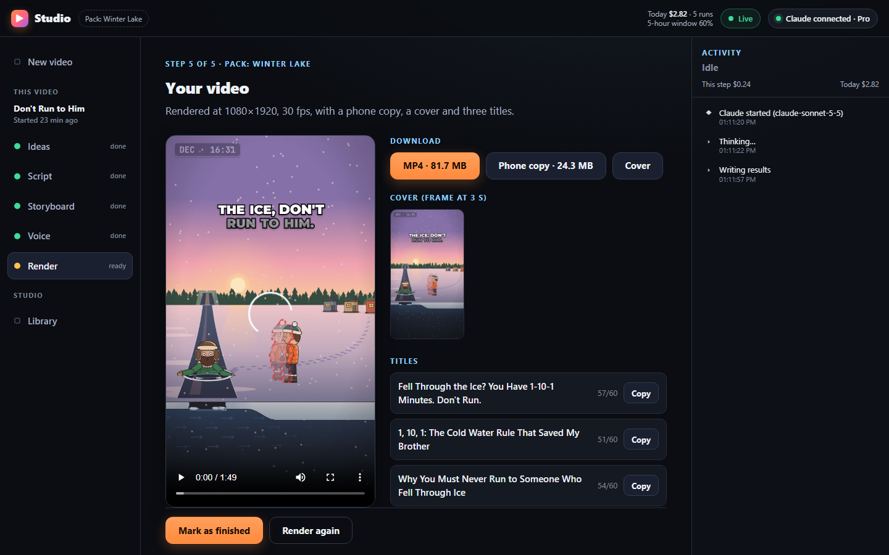
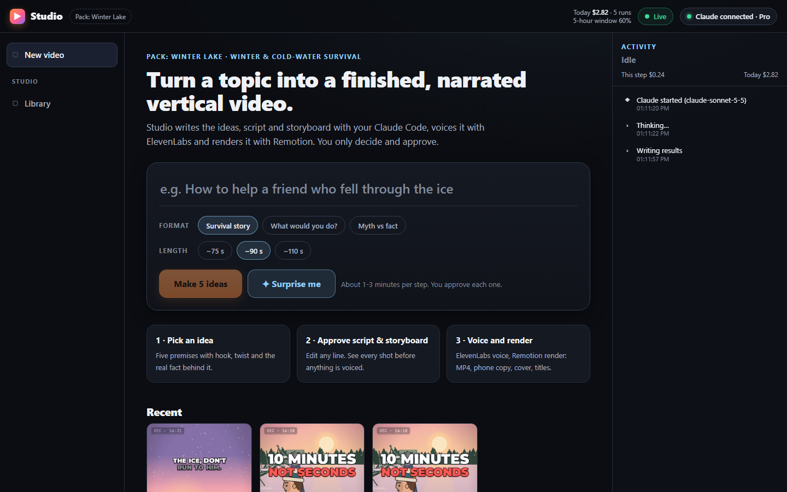
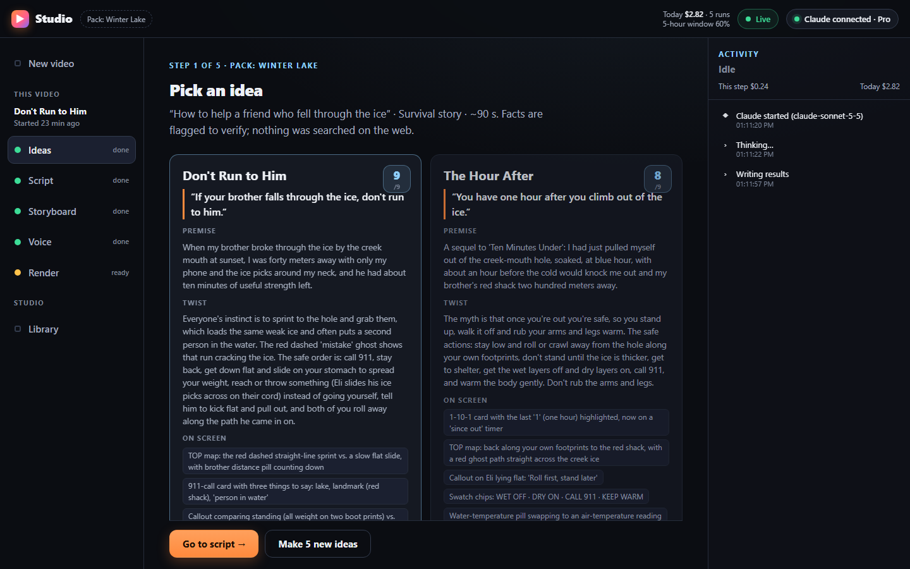
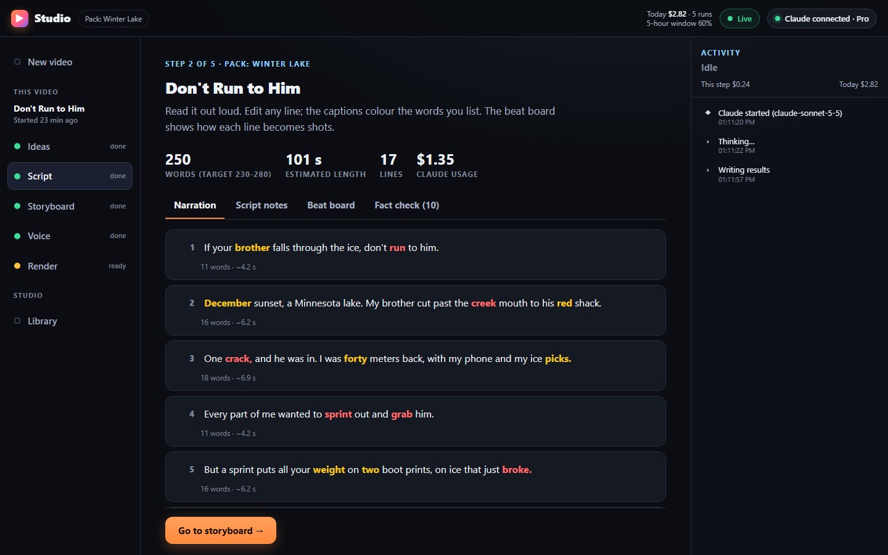
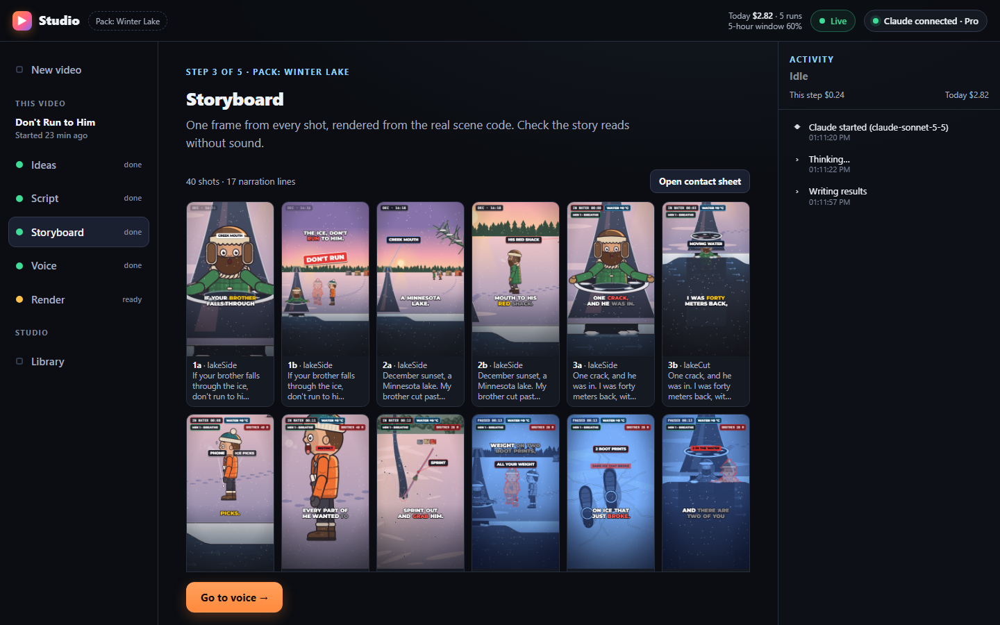
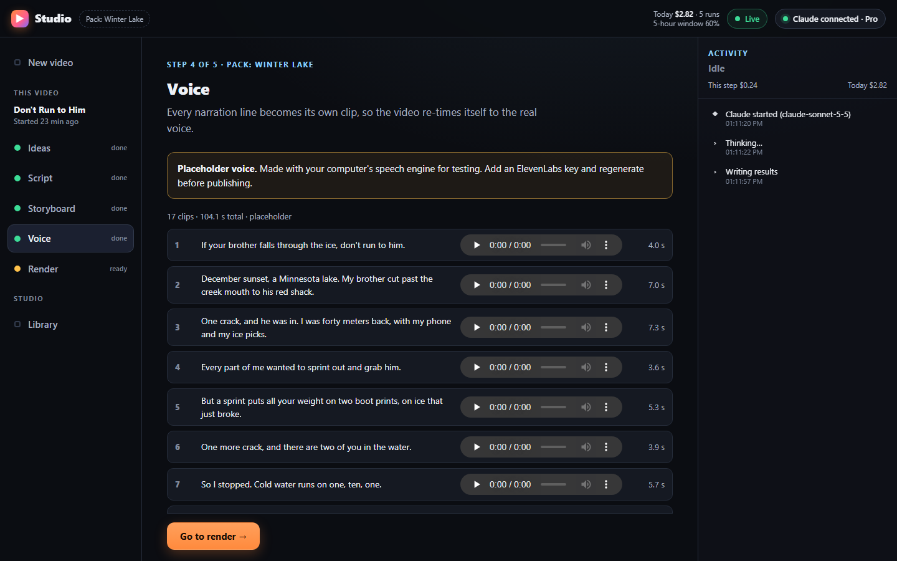
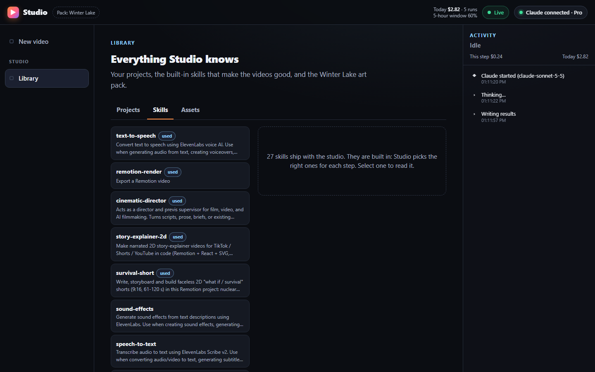

# Studio

**Turn a topic into a finished, narrated vertical 2D video.** Type a topic (or press *Surprise me*),
approve five ideas → a script → a storyboard, and get an MP4, a phone copy, a cover and three titles.

Studio is a local app. It uses **your own Claude Code** (already installed and signed in) as its AI,
**ElevenLabs** for the voice and **Remotion** for the render. You never see a terminal prompt, a skill
file or a setting: you only decide and approve.



| | | |
|---|---|---|
|  |  |  |
|  |  |  |

The screenshots show a real live run: topic *"How to help a friend who fell through the ice"* →
idea *"Don't Run to Him"* → a 250-word script → 40 shots → a 1:49 MP4 (`episodes/how-to-help-a-friend-2611071750/`;
it used the labelled placeholder voice because no ElevenLabs key was set).

## Quick start (5 minutes)

You need **Node.js 20+** and **Claude Code** signed in to your Claude account
([install guide](https://docs.claude.com/en/docs/claude-code/setup)). ElevenLabs is optional.

```bash
npm ci --ignore-scripts        # install packages (no install scripts run)
npx remotion browser ensure    # one-time: Remotion's headless browser (~120 MB)
npm run doctor                 # pass/fail table with the fix for each failure
npm start                      # opens Studio in your browser (live mode)
```

**On Windows you can also just double-click `Start Studio.cmd`** (or `Start Demo (Replay).cmd`) in this
folder; it works even in a terminal that was opened before Node was installed.

No Claude account handy, or on stage with bad Wi-Fi? Use **Replay**:

```bash
npm run demo                   # the whole flow from recorded runs: zero Claude calls, no keys
```

Replay plays back recorded stage runs and the cached outputs of the finished example episode
*Ten Minutes Under*. It is always labelled **Replay** and never pretends to be live.

`npm start` prints a private link (`http://127.0.0.1:4317/?t=…`) and opens it. Studio only listens
on 127.0.0.1 and answers only requests that carry that token.

## What happens

| Step | Who does it | What you get (in `episodes/<slug>/`) | You |
|---|---|---|---|
| Connect | Anthropic's own sign-in (`claude auth login`) | green "Claude connected" pill | one click |
| 1 Ideas | Claude Opus 5.5 (structured output) | `ideas.json`: 5 ideas with hook, twist, world, diagrams, fact, risk, score | pick one |
| 2 Script | Claude Opus 5.5 | `script.md`, `lines.json`, `shotlist.md` (beat board) | edit / approve |
| 3 Storyboard | Claude Sonnet 5.5 edits `src/shots.ts`; Studio typechecks and renders one still per shot | `storyboard.png` + stills | approve |
| 4 Voice | Studio calls ElevenLabs, one clip per line, measured with ffprobe | `voice/line-N.mp3`, `src/audio.json` | listen, accept |
| 5 Render | Remotion; Claude Sonnet writes the titles | `episode.mp4`, `episode-phone.mp4`, `cover.png`, `titles.json` | download |

Everything that makes the video good (the `story-explainer-2d`, `survival-short` and
`cinematic-director` skills, the prompts, the model routing, the art kit) is built in. You can read
the skills in **Library → Skills**.

**Pack: Winter Lake.** This MVP ships one art pack: a frozen lake at dusk, its cross-section and map
views, and two characters (Eli and his brother). Topics are therefore winter and cold-water survival.
Studio only edits episode *data*; it never draws new worlds. Other packs are future work.

**Voice without a key.** With no ElevenLabs key, Studio makes a clearly labelled *placeholder voice*
with your computer's speech engine (macOS `say`, Windows speech), so the whole flow still runs.

## Legal, safety and privacy

- **Local and non-commercial.** A hackathon project. Bring your own Claude Code login and your own
  ElevenLabs key.
- **Your Claude login stays with Claude Code.** Studio runs the `claude` program on your machine. It
  never reads, copies, logs, stores or forwards Claude credentials or tokens; it never runs
  `claude setup-token`, never uses `--bare`, and removes `ANTHROPIC_API_KEY`, `ANTHROPIC_AUTH_TOKEN`
  and `CLAUDE_CODE_OAUTH_TOKEN` from every Claude run so your subscription login is what is used
  (`npm run doctor` warns if any is set).
- **No secrets in files.** `ELEVENLABS_API_KEY` comes from your environment, or you paste it in the
  app, where it is kept in memory only. `.env*` is git-ignored.
- **ElevenLabs free plan** is non-commercial, and published videos must credit **"elevenlabs.io"** in
  the title. Studio adds the credit to the titles it writes when it detects (or cannot rule out) a
  free plan.
- **Safe survival advice only.** Widely known guidance, no chemistry, weapons, medicine doses, live
  electricity or gore; calm tone; English, US audience, metric units. Topics and scripts are checked
  in code. Facts are flagged "verify" (Studio does no web research by default).
- Remotion is free for individuals and companies of up to 3 people.
- Studio is **not affiliated with Anthropic or ElevenLabs**; their names refer only to the services you
  connect.

## Commands

| Command | What it does |
|---|---|
| `npm start` | Studio, live mode (opens the browser) |
| `npm run demo` | Studio, Replay mode (recorded runs, zero Claude calls) |
| `npm run doctor` | Environment checks with fixes |
| `npm test` | Unit + guardrail + end-to-end replay tests (`node --test app/`) |
| `npm run typecheck` | TypeScript check of the Remotion project |

Options (environment variables): `STUDIO_PORT` (default 4317), `STUDIO_NO_OPEN=1`,
`STUDIO_REPLAY_SPEED` (replay pace), `STUDIO_RECORD=1` (save a live run's activity to
`app/replays/<stage>.ndjson`), `STUDIO_CLAUDE_BIN` (path to `claude` if it is not on PATH; Studio
also finds the binary bundled with the VS Code extension).

## How it is built

```
Browser UI (vanilla ES modules, no build step)  ── HTTP + Server-Sent Events, 127.0.0.1 + token
Node server app/server.mjs (built-in http, zero framework)
 ├ engine  app/engine/claude.mjs   claude -p --output-format stream-json …, one stage at a time
 ├ parser  app/engine/parse.mjs    written against real captured runs (app/fixtures/*.ndjson)
 ├ replay  app/engine/replay.mjs   recorded runs + cached artifacts (npm run demo)
 ├ stages  app/stages/{ideas,script,shots,voice,render,extras}.mjs
 ├ doctor  app/doctor.mjs
 └ state   episodes/<slug>/state.json  (status, approvals, session ids, cost per stage)
```

- Every Claude run uses the studio folder as its working directory, so `CLAUDE.md`, the skills and the
  agents load automatically. Each stage gets exactly the tools it needs (`--allowedTools`), a spending
  cap (`--max-budget-usd`) and a timeout; blocked tools are reported, never a silent hang.
- Stage 3 may only use what the pack supports: `app/pack-catalog.json` lists every legal scene, prop,
  pose, card and HUD field and is injected into the prompt. Studio then validates the shots, runs
  the typecheck, does **one automatic repair pass** (`--resume`) if needed, and renders the storyboard.
- The Remotion project renders one episode at a time, so Studio checks each project's `shots.ts`,
  `audio.json` and voice clips in and out of `src/` (`episodes/<slug>/build/`). The example episode is
  snapshotted before anything changes.
- Errors are explained in place: Claude not installed, signed out, usage limit (job paused, state
  kept), budget cap (partial files kept), tool denied, typecheck failure, render failure (last log
  lines + Retry).

## Measured on a real run (Windows 11, Claude Pro, Claude Code 2.1.319)

| Step | Time | Claude usage (API-equivalent) |
|---|---|---|
| Ideas (Opus, high) | 1 min 48 s | $0.61 |
| Script + beat board (Opus, high) | 4 min 20 s | $1.11 |
| Shots (Sonnet, high) + typecheck + 40-still storyboard | 5 min 30 s | $0.84 |
| Voice (17 lines, placeholder) | 46 s | — |
| Render 109 s video + phone copy + cover + titles (Sonnet) | 4 min 18 s | $0.03 |
| Optional: Verify facts (Sonnet + web search) | ~1 min | $0.24 |

Replay (`npm run demo`) runs the same five steps in about 70 seconds with no Claude calls.

## Known limits

- One art pack (Winter Lake); the HUD clock always reads "DEC" and some cards carry fixed text.
- One job at a time. Pausing stops the current Claude run; *Resume* continues the same session.
- The usage meter shows the cost Claude reports (API-equivalent dollars); on a subscription this is
  plan usage, not a bill.
- Tested end to end on Windows 11. The macOS paths (`say` placeholder voice, `open`) are implemented
  but were not run in this build; Linux uses `espeak-ng` for the placeholder voice. The kit's original
  `npm run storyboard` script needs macOS (`swift`), so Studio renders storyboards with its own
  cross-platform contact sheet (`app/lib/png.mjs`).
- Stage 3 can only rearrange what the pack already draws. In the live run a few extreme close-ups crop
  the head and one stamp overlaps a speech bubble; there is no automatic art-director pass yet.

See [`docs/demo-script.md`](docs/demo-script.md) for the 3-minute demo.
