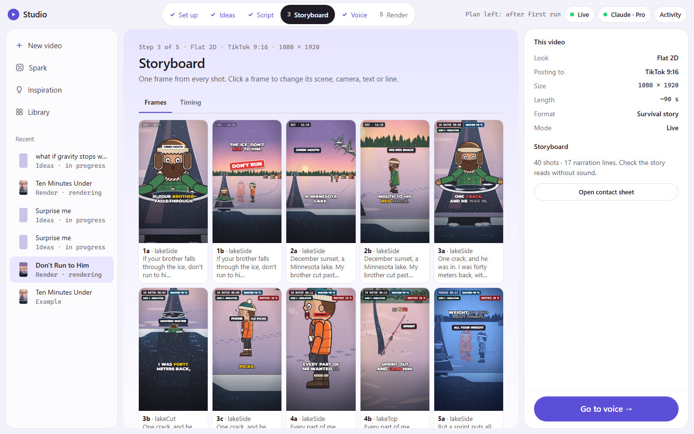
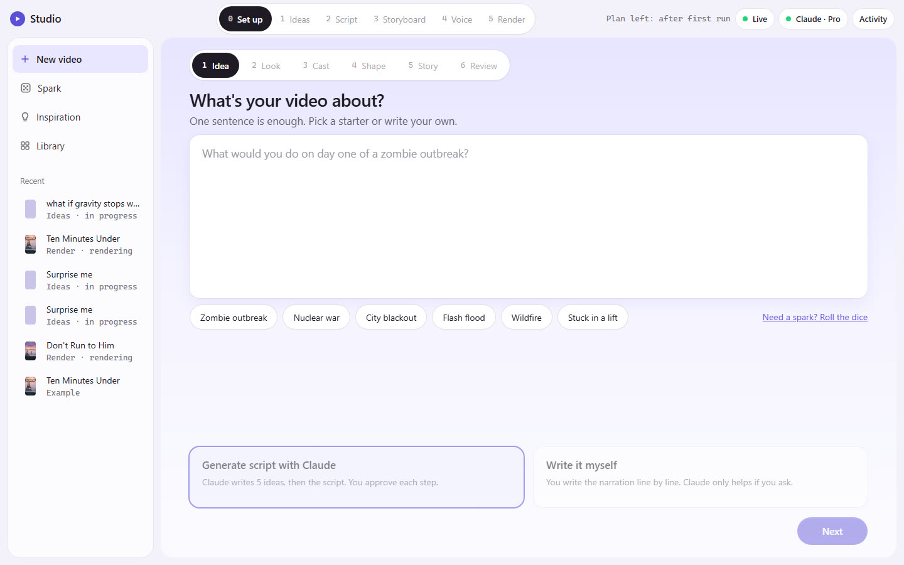
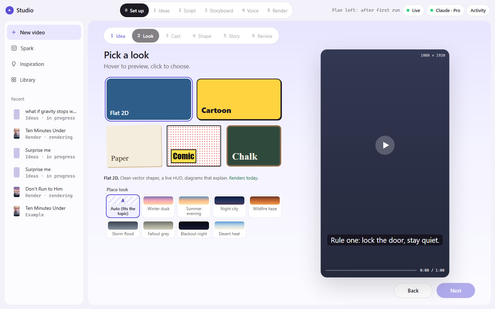
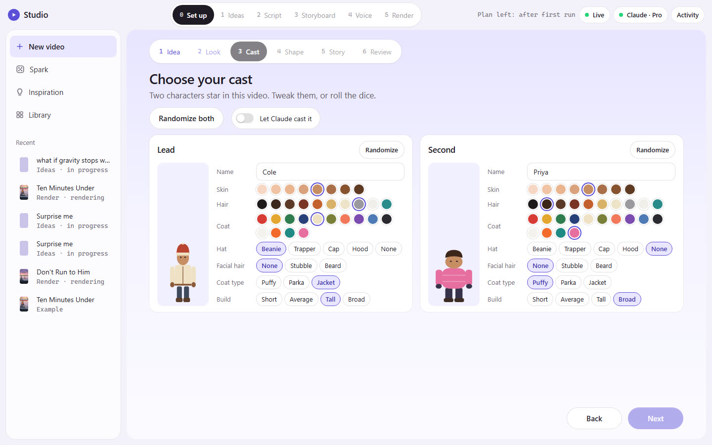
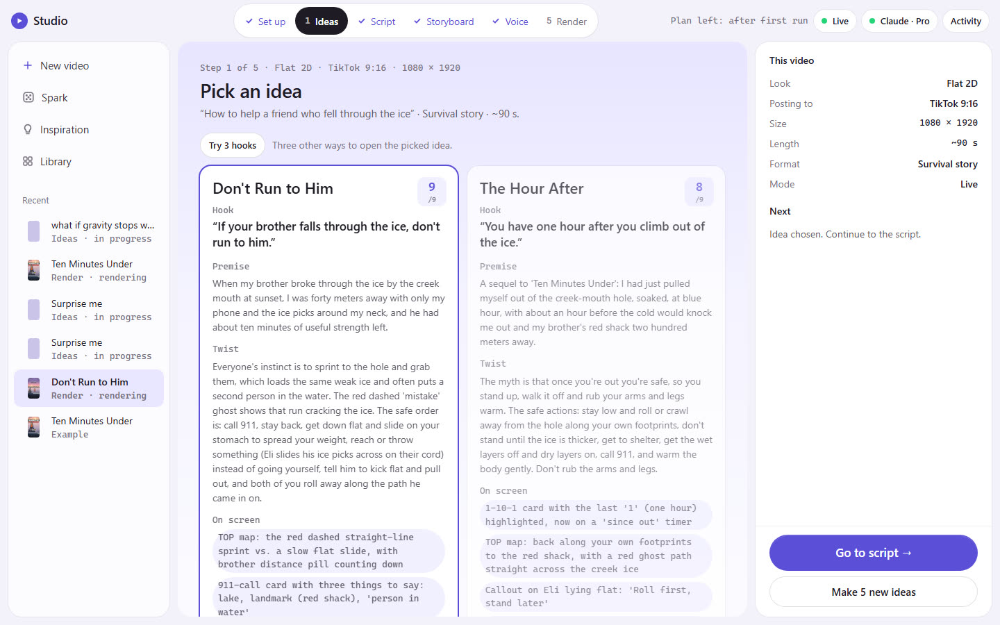
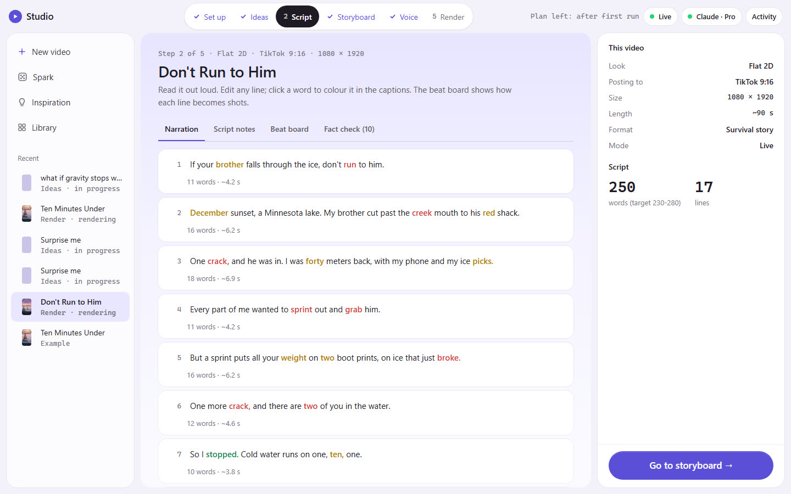
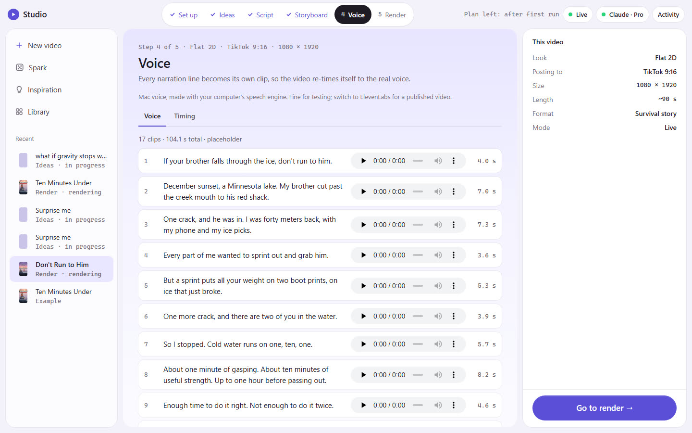
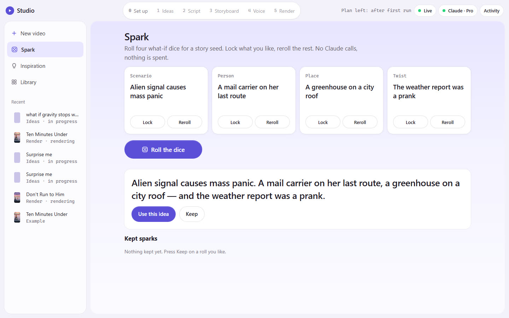
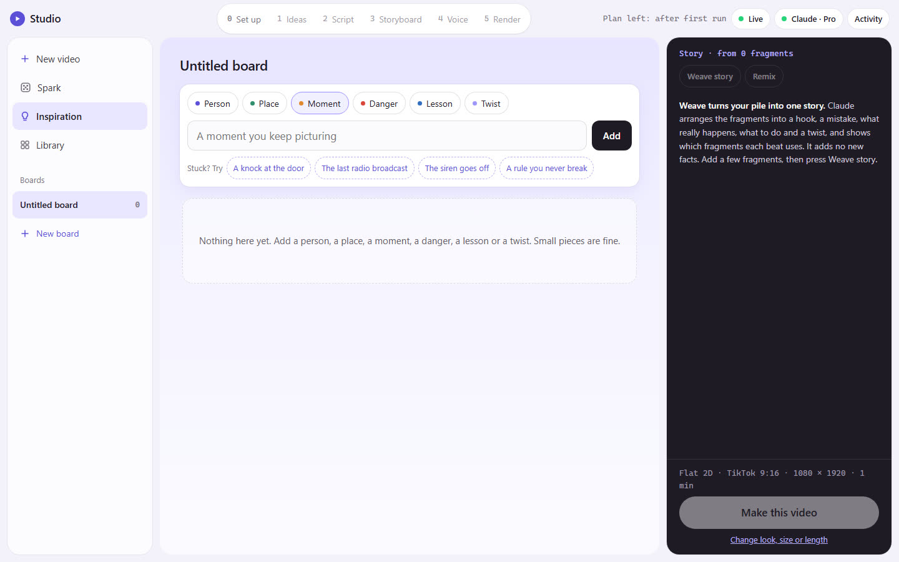
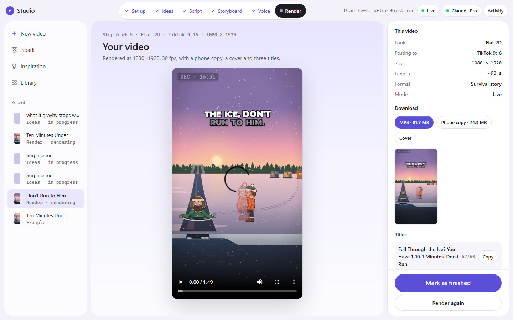

# Studio Gen

**Turn one sentence into a finished video.** Type a topic, and Studio Gen helps you make a short,
narrated, animated video for TikTok, Shorts or Reels. You get an MP4, a phone-sized copy, a cover
picture and three title ideas.

You stay in control. You only look at each step and click **approve**:
**ideas → script → storyboard → voice → video.**



| | | |
|---|---|---|
|  |  |  |
|  |  |  |
|  |  |  |

The screenshots come from a real run: the topic *"How to help a friend who fell through the ice"*
became a 250-word script, 40 scenes and a 1 minute 49 second video. It used a basic computer voice
because no ElevenLabs key was set.

## What you need

| You need | Why | Cost |
|---|---|---|
| A computer with **Node.js 20 or newer** ([download](https://nodejs.org)) | Runs the app | Free |
| **Claude Code**, signed in to your Claude account ([install guide](https://docs.claude.com/en/docs/claude-code/setup)) | The AI that writes your video | Uses your Claude plan |
| About 2 GB of free disk space | App files and a small built-in browser used for drawing the video | Free |
| An **ElevenLabs** account (optional) | A natural voice. Without it, your computer reads the script in its own voice | Free plan available |

## Start in 3 steps

**1. Install (once).** Open a terminal in this folder and run:

```bash
npm ci --ignore-scripts
npx remotion browser ensure
```

**2. Check that everything works (optional, but it tells you how to fix any problem).**

```bash
npm run doctor
```

**3. Start the app.**

```bash
npm start
```

Your browser opens Studio Gen. Type a topic and follow the screens.

**Prefer to avoid the terminal?** Double-click **Start Studio.command** on a Mac or
**Start Studio.cmd** on Windows.

**Just want to look around, with no Claude account?** Run `npm run demo`, or double-click
**Start Demo (Replay).command** / **Start Demo (Replay).cmd**. It plays a recorded example, uses no
Claude and needs no keys. It is always labelled **Replay**.

> If Studio shows "Open Studio from the terminal link", copy the link that starts with `Open:`
> from the terminal window and paste it into your browser. The link is private to your computer.

## How to make a video

1. **Pick a topic.** Choose one of these:
   - **New video:** a short guided setup. Write one sentence (or pick a starter like *Flash flood* or
     *City blackout*), choose a look, name your two characters, and choose the length and format.
   - **Spark:** roll four dice (scenario, person, place, twist), keep the ones you like and use the
     idea. It is free and uses no Claude.
   - **Inspiration:** drop short notes (a person, a place, a danger, a lesson, a twist) on a board.
     Press *Weave story* and Claude turns them into a story.
2. **Approve the idea.** Claude suggests five ideas. Pick one.
3. **Approve the script.** Claude writes it. You can edit any line.
4. **Approve the storyboard.** Studio draws one picture for each scene. You can adjust them.
5. **Choose the voice.** Use ElevenLabs, your computer's voice, or no voice (captions only).
6. **Get your video.** Studio makes the MP4, a smaller phone copy, a cover and three titles. Your
   files are saved in the `episodes` folder, in a folder named after your video.

**Make the next episode:** turn a finished video into a series. The new episode keeps the same
characters, look and format, and Claude gets a short "previously" note.

**Formats and length:** vertical (TikTok, Shorts, Reels), widescreen (YouTube), square, 4:5, or a
custom size. Videos can be 20 to 180 seconds long.

**Your Claude plan is protected.** The top bar shows how much of your Claude plan is left. Studio
won't start a step that would run past your limit, and if a limit is reached mid-step it pauses and
keeps your work.

## Something not working?

Run `npm run doctor` first. It shows a pass/fail table and the fix for each problem. The most common
ones:

| What you see | What to do |
|---|---|
| "Claude Code not installed" or "signed out" | Install Claude Code ([guide](https://docs.claude.com/en/docs/claude-code/setup)) and sign in with `claude auth login`, then reload Studio. |
| "Open Studio from the terminal link" | Copy the link that starts with `Open:` from the terminal window into your browser. |
| The port is already in use | Another Studio is probably running. Close it, or start this one on another port with `STUDIO_PORT=4400 npm start`. |
| The video voice sounds robotic | No ElevenLabs key is set, so your computer's voice is used. Add a key on the Voice screen for a natural voice. |
| A step stopped part-way | Your Claude plan limit was probably reached. The work is kept. Press *Resume* when your limit resets. |
| A render failed | Studio shows the last lines of the log and a *Retry* button. |

## Good to know

- **Art:** this version comes with one art pack, *Winter Lake* (a frozen lake and two characters).
  Topics can be anything survival-safe, such as floods, blackouts or wildfires, and the look options
  change the colours and writing style. The drawings are still the lake. More art packs are planned.
- **One job at a time.** You can pause a step and resume it later.
- **Computers:** tested from start to finish on Windows 11. Mac launchers are included. Linux needs
  `espeak-ng` for the basic computer voice.
- **Storyboard:** Studio can only rearrange what the art pack already draws, so a few close-up shots
  may crop a head. Check the storyboard before you approve it.
- **Safe topics only.** Studio avoids chemistry, weapons, medicine doses, live electricity and gore.
  The tone is calm, in English, for a US audience, with metric units. Facts are marked "verify", so
  please double-check them before you publish.
- **Costs are estimates.** The dollar amounts are what Claude reports. On a Claude plan they count
  toward your usage limit and are marked "not billed".

## Privacy and rules

- **Everything runs on your computer.** Studio only listens on your own machine and needs its
  private link to open.
- **Your Claude login stays with Claude Code.** Studio never reads, copies, stores or sends your
  login. It runs the `claude` program you already have.
- **No secrets in files.** Your `ELEVENLABS_API_KEY` is read from your computer's environment, or you
  paste it into the app, where it is kept in memory only.
- **ElevenLabs free plan:** it is for non-commercial use, and published videos must credit
  **"elevenlabs.io"** in the title. Studio adds the credit to the titles it writes when it finds, or
  cannot rule out, a free plan.
- **Local and non-commercial.** This is a hackathon project. Remotion, the video tool inside, is free
  for individuals and companies of up to 3 people.
- Studio Gen is **not affiliated with Anthropic or ElevenLabs**. Their names only refer to the
  services you connect.

## How long does it take?

A real run on Windows 11 with a Claude Pro plan:

| Step | Time |
|---|---|
| Ideas | 1 min 48 s |
| Script and scene plan | 4 min 20 s |
| Storyboard (40 pictures) | 5 min 30 s |
| Voice (basic computer voice) | 46 s |
| Final video, phone copy, cover and titles | 4 min 18 s |

Replay mode (`npm run demo`) shows the same five steps in about 70 seconds.

## For developers

**Commands**

| Command | What it does |
|---|---|
| `npm start` | Studio, live mode (opens the browser) |
| `npm run demo` | Studio, Replay mode (recorded runs, zero Claude calls) |
| `npm run doctor` | Environment checks with fixes |
| `npm test` | Unit, guardrail, plan-guard and end-to-end replay tests (`app/test/*.test.mjs`) |
| `npm run typecheck` | TypeScript check of the Remotion project |

**Options** (environment variables)

- `STUDIO_PORT`: the port Studio listens on (default 4317).
- `STUDIO_NO_OPEN=1`: don't open the browser at start.
- `STUDIO_REPLAY_SPEED`: how fast Replay plays back.
- `STUDIO_RECORD=1`: save a live run's activity to `app/replays/<stage>.ndjson`.
- `STUDIO_CLAUDE_BIN`: the path to `claude` if it isn't on PATH. Studio also finds the binary bundled
  with the VS Code extension.

**Who does what at each step**

| Step | Who does it | Files in `episodes/<slug>/` |
|---|---|---|
| 1 Ideas | Claude Opus 5.5 | `ideas.json` |
| 2 Script | Claude Opus 5.5 | `script.md`, `lines.json`, `shotlist.md` |
| 3 Storyboard | Claude Sonnet 5.5 edits `src/shots.ts`; Studio typechecks and renders one still per shot | stills, timing table |
| 4 Voice | ElevenLabs, your computer's voice, or none | `voice/line-N.mp3`, `src/audio.json` |
| 5 Render | Remotion; Claude Sonnet writes the titles | `episode.mp4`, `episode-phone.mp4`, `cover.png`, `titles.json` |

**How it is built**

```
Browser UI (vanilla ES modules, no build step)  ── HTTP + Server-Sent Events, 127.0.0.1 + token
Node server app/server.mjs (built-in http, zero framework)
 ├ engine  app/engine/claude.mjs   claude -p --output-format stream-json …, one stage at a time, plan guard
 ├ parser  app/engine/parse.mjs    written against real captured runs (app/fixtures/*.ndjson)
 ├ replay  app/engine/replay.mjs   recorded runs + cached artifacts (npm run demo)
 ├ stages  app/stages/{ideas,script,shots,voice,render,extras,cast,hooks,weave,sequel}.mjs
 ├ doctor  app/doctor.mjs
 └ state   episodes/<slug>/state.json  (status, approvals, session ids, cost per stage)
```

- **Claude runs:** each one uses the studio folder as its working directory, so `CLAUDE.md`, the skills
  and the agents load automatically. Each stage gets exactly the tools it needs (`--allowedTools`), a
  spending cap (`--max-budget-usd`) and a timeout.
- **Storyboard:** `app/pack-catalog.json` lists every legal scene, prop, pose, card and HUD field and
  goes into the prompt. Studio validates the shots, runs the typecheck, does one automatic repair pass
  if needed, and renders the storyboard.
- **One episode at a time:** the Remotion project renders one episode at a time, so Studio checks each
  project's `shots.ts`, `audio.json`, cast and voice clips in and out of `src/`.
- **Landing page:** the website lives in [`site/`](site/), a static page deployed on Vercel with Root
  Directory = `site`. See `site/README.md`.

See [`docs/demo-script.md`](docs/demo-script.md) for the 3-minute demo and [`AGENTS.md`](AGENTS.md)
for working on the code.
